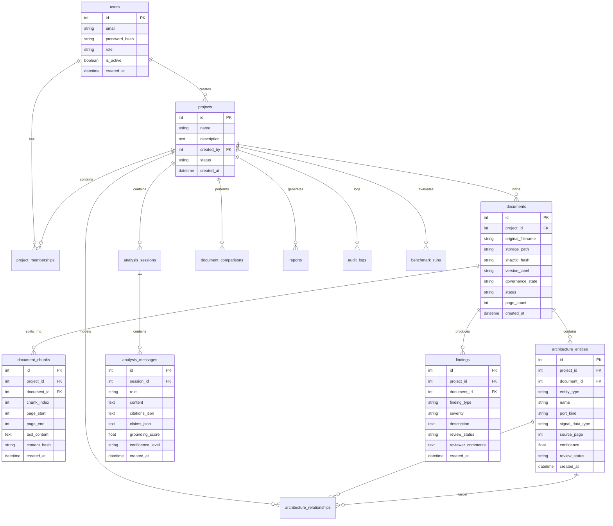

# AUTOSAR AI — Relational & Vector Database Design

## 1. Storage Architecture Overview
AUTOSAR AI uses a **hybrid dual-storage architecture**:
1. **SQLite 3 (via SQLAlchemy 2.0 ORM)**: Stores all structured, relational business entities, user accounts, document metadata, extracted architectural components, findings, comparisons, chat sessions, and audit trails.
2. **ChromaDB 0.4.24**: Persistent vector database storing 384-dimensional dense vectors and chunk text content for semantic nearest-neighbor retrieval.

---

## 2. Entity-Relationship Diagram (Mermaid)

---

## 3. Relational Table Schemas

### 3.1 `users`
- Stores user accounts and authorization roles.
- Columns: `id` (PK), `email` (Unique), `password_hash`, `role` (admin, architect, viewer), `is_active`, `created_at`, `updated_at`.

### 3.2 `projects`
- Multi-project tenant boundary.
- Columns: `id` (PK), `name` (Index), `description`, `created_by` (FK -> `users.id`), `status`, `created_at`, `updated_at`.

### 3.3 `project_memberships`
- Associates users with projects with role-based access.
- Columns: `id` (PK), `project_id` (FK -> `projects.id`), `user_id` (FK -> `users.id`), `role`, `created_at`.

### 3.4 `documents`
- Tracks uploaded HLD documents, hash fingerprints, version labels, and governance states.
- Columns: `id` (PK), `project_id` (FK -> `projects.id`), `original_filename`, `storage_path`, `sha256_hash`, `version_label`, `governance_state` (DRAFT, IN_REVIEW, APPROVED), `status` (UPLOADED, INDEXED, ERROR), `page_count`, `metadata_json`, `error_message`, `uploaded_by` (FK -> `users.id`), `created_at`, `updated_at`.

### 3.5 `document_chunks`
- Stores character slices with page boundaries and hashes.
- Columns: `id` (PK), `project_id` (FK -> `projects.id`), `document_id` (FK -> `documents.id`), `chunk_index`, `page_start`, `page_end`, `section_heading`, `version_label`, `text_content`, `content_hash`, `created_at`.

### 3.6 `architecture_entities`
- Extracted AUTOSAR components, runnables, interfaces, ports, and signals.
- Columns: `id` (PK), `project_id` (FK -> `projects.id`), `document_id` (FK -> `documents.id`), `entity_type` (SWC, Runnable, Interface, Port, Signal), `name`, `description`, `source_page`, `source_excerpt`, `extraction_method` (regex, heuristic), `confidence`, `review_status` (pending, confirmed, rejected), `port_kind` (PPort, RPort), `port_direction` (Input, Output), `interface_name`, `signal_data_type`, `owner_component`, `carried_signals`, `properties_json`, `created_at`, `updated_at`.

### 3.7 `architecture_relationships`
- Component-to-component dependencies and communication links.
- Columns: `id` (PK), `project_id` (FK -> `projects.id`), `document_id` (FK -> `documents.id`), `source_entity_id` (FK -> `architecture_entities.id`), `target_entity_id` (FK -> `architecture_entities.id`), `relationship_type` (communicates_with, invokes, sends_to), `source_excerpt`, `source_page`, `review_status`, `created_at`.

### 3.8 `analysis_sessions`
- Groups chat dialogues within a project.
- Columns: `id` (PK), `project_id` (FK -> `projects.id`), `user_id` (FK -> `users.id`), `title`, `created_at`, `updated_at`.

### 3.9 `analysis_messages`
- Individual chat exchanges with citations and grounding scores.
- Columns: `id` (PK), `session_id` (FK -> `analysis_sessions.id`), `role` (user, assistant, system), `content`, `citations_json`, `metadata_json`, `claims_json`, `grounding_score`, `confidence_level`, `review_recommendation`, `review_decision`, `reviewer_id`, `review_feedback`, `corrected_facts`, `reviewed_at`, `created_at`.

### 3.10 `findings`
- Architecture rule violations and verification issues.
- Columns: `id` (PK), `project_id` (FK -> `projects.id`), `document_id` (FK -> `documents.id`), `finding_type` (CIRCULAR_DEPENDENCY, INSECURE_IPC, MISSING_PORT_BINDING), `severity` (Critical, High, Medium, Low), `description`, `evidence_json`, `review_status` (open, confirmed, resolved, false_positive), `reviewer_comments`, `created_at`, `updated_at`.

### 3.11 `document_comparisons`
- Records diff comparisons between baseline and revision documents.
- Columns: `id` (PK), `project_id` (FK -> `projects.id`), `baseline_document_id` (FK -> `documents.id`), `comparison_document_id` (FK -> `documents.id`), `status`, `results_json`, `created_by` (FK -> `users.id`), `created_at`.

### 3.12 `reports`
- Catalog of generated export files.
- Columns: `id` (PK), `project_id` (FK -> `projects.id`), `document_id` (FK -> `documents.id`), `report_type`, `format` (CSV), `storage_path`, `generated_by` (FK -> `users.id`), `created_at`.

### 3.13 `audit_logs`
- Immutable audit log of all critical engineering decisions and status transitions.
- Columns: `id` (PK), `project_id` (FK -> `projects.id`), `user_id` (FK -> `users.id`), `action`, `resource_type`, `resource_id`, `details_json`, `created_at`.

### 3.14 `benchmark_runs`
- Evaluation benchmark run records.
- Columns: `id` (PK), `project_id` (FK -> `projects.id`), `dataset_version`, `retrieval_strategy`, `top_k`, `total_queries`, `completed_queries`, `failed_queries`, `mrr`, `hit_rate_at_1`, `citation_precision`, `supported_claim_rate`, `abstention_accuracy`, `avg_latency_ms`, `results_json`, `created_at`.

---

## 4. ChromaDB Vector Store Organization
- **Disk Path**: `./data/vector_store`
- **Collection Naming**: `project_{project_id}`
- **Vector Dimension**: 384 dimensions (`all-MiniLM-L6-v2`)
- **Metadata Fields**: `document_id`, `chunk_index`, `page_start`, `page_end`, `version_label`, `section_heading`
- **Cascade Deletion**: When a document is deleted from SQLite, `delete_chunks_by_document(project_id, document_id)` deletes all corresponding vector records from ChromaDB.
