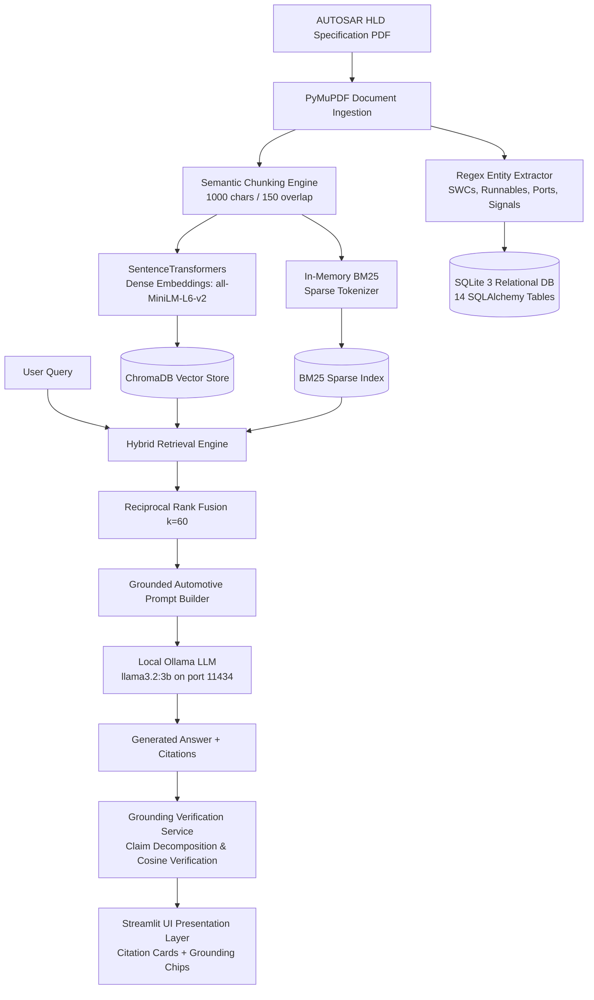

# Documentation — AUTOSAR AI Intelligence Platform

This directory contains the formal technical deliverables, academic engineering reports, system architecture specifications, database schemas, REST API documentation, and viva defense guides for the **AUTOSAR AI — High-Level Design Document Intelligence Platform**.

---

## 1. Technical Reports Inventory & Distinction

The project maintains two distinct, comprehensive reports to satisfy both industry evaluation standards and university capstone guidelines:

| File | Document Name | Scope & Purpose | Target Audience |
| :--- | :--- | :--- | :--- |
| [`AUTOSAR_AI_Technical_Report_Hamdhan_Ahmed_B.pdf`](AUTOSAR_AI_Technical_Report_Hamdhan_Ahmed_B.pdf) *(also mirrored as [`Technical_Report.pdf`](Technical_Report.pdf))* | **Comprehensive Technical Report** (42 sections, 95 paragraphs, 792 KB) | **Primary flagship engineering document.** Contains exhaustive technical depth: 8-layer decoupled architecture, hybrid RAG pipeline (BM25 + Chroma), claim-level grounding verification, AST entity extraction, ISO 26262 / ISO 21434 compliance, and 35-query empirical benchmark results. | **Tata Technologies Tech Pulse Judges, Automotive Architects, Industry Evaluators** |
| [`Project_Report.pdf`](Project_Report.pdf) *([`Project_Report.docx`](Project_Report.docx))* | **Academic Capstone Project Report** (10 chapters, 235 KB) | Formal university thesis format including institutional certificate, departmental approvals, literature survey, and academic chapter organization. | **University Academic Reviewers, Guide & Faculty Committee** |

---

## 2. Engineering Specifications & Technical Guides

| Guide | Scope & Content |
| :--- | :--- |
| [`System_Architecture.md`](System_Architecture.md) | Exhaustive breakdown of the 8 decoupled architectural layers, Mermaid sequence & component diagrams, technology stack rationale, and data flow models. |
| [`Internal_Working.md`](Internal_Working.md) | In-depth algorithmic explanation of PyMuPDF text parsing, 1000-char sliding window chunking with 150-char overlap, Reciprocal Rank Fusion ($k=60$), and claim-level grounding verification. |
| [`Database_Design.md`](Database_Design.md) | Entity-Relationship (ER) model and schema documentation for all 14 SQLite relational tables, SQLAlchemy ORM mappings, ChromaDB collection metadata, and Alembic migrations. |
| [`API_Documentation.md`](API_Documentation.md) | Complete OpenAPI/REST endpoint reference covering all 10 API routers, request/response JSON schemas, error codes, and curl examples. |
| [`Installation_and_Execution.md`](Installation_and_Execution.md) | Step-by-step local execution guide for Windows 11 and Linux, virtual environment creation, Ollama setup, and port configuration. |
| [`Troubleshooting.md`](Troubleshooting.md) | Diagnostic guide for common issues: Ollama connectivity timeouts, PyMuPDF parsing errors, ChromaDB lock resolution, and port conflicts. |
| [`Viva_Questions_and_Answers.md`](Viva_Questions_and_Answers.md) | 80+ in-depth, categorized viva defense questions and answers covering automotive standards, RAG theory, grounding mathematics, and safety compliance. |
| [`Limitations_and_Future_Scope.md`](Limitations_and_Future_Scope.md) | Transparent appraisal of current system boundaries (text-based PDFs, heuristic entity regex) and future roadmap (ARXML AST parsing, CAN bus timing simulation). |
| [`Cleanup_Report.md`](Cleanup_Report.md) | Comprehensive audit log documenting the safe reorganization of the workspace with zero loss of source code or data. |

---

## 3. Architecture Workflow Overview

