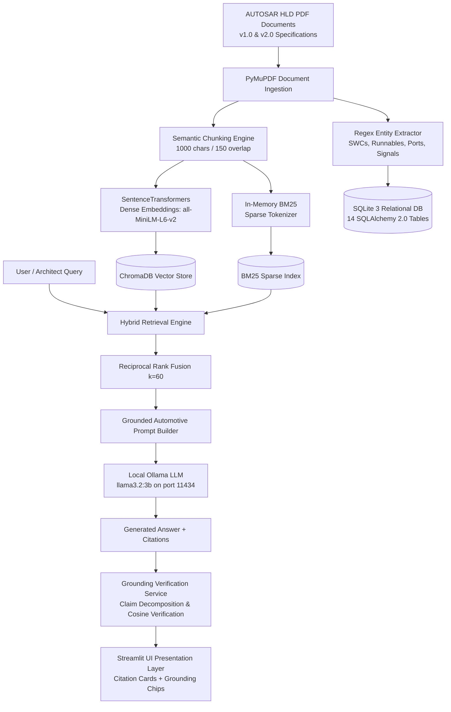

# AUTOSAR AI — High-Level Design Document Intelligence Platform

[](https://www.python.org/)
[](https://fastapi.tiangolo.com/)
[](https://streamlit.io/)
[](https://www.trychroma.com/)
[](https://ollama.ai/)
[](Evaluation_Results/Test_Results.md)
[](LICENSE_OR_USAGE_NOTES.md)

**Capstone Project & Tata Technologies Tech Pulse Submission**<br/>
**Repository:** [https://github.com/hamdhan05/SASTRA_Hamdhan_Ahmed_B_127003081_CSE_AIML](https://github.com/hamdhan05/SASTRA_Hamdhan_Ahmed_B_127003081_CSE_AIML)<br/>
**Candidate:** Hamdhan Ahmed B (Register No: 127003081)<br/>
**Program:** B.Tech. Computer Science & Engineering (AI & ML), SASTRA Deemed to be University, Thanjavur, India

---

## 1. Project Title and Summary

**AUTOSAR AI: An On-Premises, Factual Verification, and Traceability Platform for Automotive Software High-Level Design Specifications**

Modern automotive engineering governed by the AUTOSAR standard demands zero-tolerance for architectural inconsistencies and hallucinated interfaces in safety-critical vehicle functions. **AUTOSAR AI** is an enterprise-grade automotive engineering platform designed to ingest, analyze, trace, and verify complex High-Level Design (HLD) specifications across release versions (v1.0 and v2.0). 

By uniting **two-stage hybrid retrieval (Dense ChromaDB + Sparse BM25 with Reciprocal Rank Fusion)**, **local offline LLM reasoning (`llama3.2:3b` via Ollama)**, **deterministic architectural entity heuristics (SWCs, Runnables, Ports, Signals)**, and an **independent claim-level grounding verification service**, the platform eliminates generative hallucinations and provides verifiable physical page citations while ensuring 100% on-premises data privacy under ISO/SAE 21434 and ISO 26262.

---

## 2. Problem Statement and Intended Users

### Problem Statement
Automotive software architectures under AUTOSAR Classic and Adaptive standards encompass hundreds of interconnected Software Components (SWCs), execution Runnables, communication Ports (PPorts, RPorts), and carried Signals. Engineering teams face major operational bottlenecks:
- **Manual Revision Cross-Referencing:** Comparing baseline architectures against evolved revisions (e.g., v1.0 vs. v2.0) is labor-intensive, error-prone, and frequently misses altered signal data types or deprecated interfaces.
- **Data Privacy & Cybersecurity (ISO/SAE 21434):** Strict automotive security regulations forbid uploading proprietary vehicle blueprints to public cloud LLMs.
- **Generative Hallucinations (ISO 26262):** Generic language models fabricate non-existent CAN/Ethernet signals, misattribute component interfaces, and lack verifiable provenance.
- **Pure Vector Search Failures:** Semantic-only embedding models confuse distinct architectural identifiers sharing textual similarity (e.g., confusing `sig_MotorTorque` with general vehicle velocity references).

### Intended Users
- **Automotive Software Architects:** Reviewing component allocations, boundary integrity, and interface contracts.
- **Functional Safety & Systems Engineers:** Auditing signal paths, dependency cycles, and ASIL allocations.
- **Tier-1 Suppliers & OEMs:** Validating incoming HLD specifications against implementation baselines and compliance requirements.

---

## 3. Key Capabilities Actually Implemented

1. **Document Ingestion & Physical Provenance Tracking:**
   - Ingests multi-version AUTOSAR HLD PDFs using PyMuPDF (`fitz`) at C-speed, preserving physical page numbers and section hierarchy.
   - Deterministic sliding-window chunking (1000 characters with 150-character overlap) avoiding arbitrary boundary truncation.
2. **Domain Entity Heuristic Extraction:**
   - Heuristic regex parsers extract Software Components (SWCs), Runnables, PPorts, RPorts, Interfaces, and Signals with their AUTOSAR data types (`uint8`, `float32`, `boolean`).
   - Dynamic interactive Mermaid component dependency graphs rendered directly in the UI.
3. **Multi-Signal Hybrid Retrieval & Rank Fusion:**
   - Fuses dense semantic search (`all-MiniLM-L6-v2` embeddings in ChromaDB) with sparse keyword matching (in-memory BM25 tokenizer) using Reciprocal Rank Fusion ($k=60$).
4. **On-Premises Grounded Generation:**
   - Local LLM inference powered by Ollama (`llama3.2:3b`) operating offline on `http://127.0.0.1:11434`.
   - Domain-specific grounded system prompt enforcing exact page citations (e.g., `[Page 4]`) and zero external leakage.
5. **Claim-Level Grounding Verification & Abstention:**
   - Generated answers are segmented into atomic claims and cross-verified against citation excerpts.
   - Computes a numerical Grounding Score ($0.0 \text{ to } 1.0$) with confidence classification (**High**, **Moderate**, **Low**).
   - 100% honest abstention on out-of-scope or unanswerable queries.
6. **Cross-Revision Comparative Diff & Rename Detection:**
   - Diffs baseline vs. evolved specifications, detecting added, removed, or modified components, and flagging signal type mutations.
7. **Automated Architectural Rule Validation:**
   - Detects circular dependencies between SWCs, orphaned components, and insecure inter-process communication (IPC).
8. **Sanitized CSV & Markdown Compliance Reports:**
   - Generates downloadable audit reports with CSV formula injection protection (`=`, `+`, `-`, `@`).

---

## 4. System Architecture & Workflow



---

## 5. Technology Stack Verified from Source Code

| Architectural Subsystem | Technology / Library | Version / Details | Role in Platform |
| :--- | :--- | :--- | :--- |
| **Frontend Presentation** | Streamlit | `>=1.32.0` | 9-page reactive web UI with glassmorphism styling |
| **Backend API** | FastAPI + Uvicorn | `>=0.110.0` | Asynchronous REST API with 10 modular routers |
| **Document Ingestion** | PyMuPDF (`fitz`) | `>=1.23.26` | High-speed PDF text parsing & page provenance tracking |
| **Dense Embeddings** | SentenceTransformers | `>=2.5.1` (`all-MiniLM-L6-v2`) | Generates 384-dimensional semantic dense vectors |
| **Vector Store** | ChromaDB | `>=0.4.24` | Local persistent vector indexing & cosine similarity |
| **Sparse Retrieval** | In-Memory BM25 | Pure Python | Exact keyword matching for automotive tokens |
| **Relational Database** | SQLite 3 + SQLAlchemy | `>=2.0.28` | 14 relational tables managing documents, entities, findings |
| **Database Migrations** | Alembic | `>=1.13.1` | Declarative schema migrations and versioning |
| **Local LLM Engine** | Ollama (`llama3.2:3b`) | Local Daemon | Offline, on-premises generative reasoning on port 11434 |
| **Testing Framework** | Pytest | `>=8.0.2` | 28 automated unit tests with 100% pass rate |

---

## 6. Repository Folder Guide

```text
├── Code/                          # Production source code, FastAPI, Streamlit, tests, launcher
│   ├── backend/                   # FastAPI backend services, database models, API routers
│   ├── frontend/                  # Streamlit 9-page user interface application
│   ├── tests/                     # 28 automated unit tests across 12 modules
│   ├── scripts/                   # Utility and deployment packaging scripts
│   ├── data/                      # Local SQLite DB, ChromaDB vector store, sample uploads
│   ├── requirements.txt           # Pinned Python package dependencies
│   ├── Dockerfile                 # Production Docker image specification
│   ├── docker-compose.yml         # Container orchestration specification
│   ├── .env.example               # Sanitized environment variable template
│   └── run.py                     # Single-command launcher with auto-port detection
├── Declarations/                  # Institutional declarations and ethics documentation
│   ├── AUTOSAR_AI_Academic_Integrity_AI_Tool_Declaration_Hamdhan_Ahmed_B.docx
│   ├── AUTOSAR_AI_Academic_Integrity_AI_Tool_Declaration_Hamdhan_Ahmed_B.pdf
│   ├── Student_Declaration_Template.docx
│   ├── Student_Declaration_Template.pdf
│   └── Submission_Checklist.md    # University & competition verification checklist
├── Documentation/                 # Technical reports, system architecture, API specifications
│   ├── AUTOSAR_AI_Technical_Report_Hamdhan_Ahmed_B.pdf  # Primary Comprehensive Technical Report
│   ├── Technical_Report.pdf                             # Quick access technical report mirror
│   ├── Project_Report.pdf                               # University capstone thesis format
│   ├── System_Architecture.md     # 8-layer decoupled architecture breakdown
│   ├── Internal_Working.md        # Algorithmic deep-dive into RAG and grounding
│   ├── Database_Design.md         # 14 relational tables and ER diagram
│   ├── API_Documentation.md      # OpenAPI REST endpoint reference
│   ├── Installation_and_Execution.md # Local execution guide
│   ├── Troubleshooting.md         # Diagnostic steps and common fixes
│   └── Viva_Questions_and_Answers.md # 80+ defense questions and answers
├── Evaluation_Results/            # Empirical benchmark records and test evidence
│   ├── Test_Results.md            # Pytest execution log (28/28 passed in 27.35s)
│   ├── Feature_Verification_Matrix.md # Requirements-to-code traceability matrix
│   ├── Evaluation_Results.csv     # Quantitative 35-query benchmark metrics table
│   └── Sample_Output/             # Grounded JSON responses and sanitized CSV reports
├── Input_Data/                    # Architectural HLD specifications and query datasets
│   ├── AUTOSAR_HLD_v1.0.pdf       # Powertrain & Sensor Management baseline spec
│   ├── AUTOSAR_HLD_v2.0.pdf       # Autonomous Driving & Diagnostics evolved spec
│   ├── Sample_HLD_Documents/      # Additional synthetic automotive test documents
│   └── Sample_Query_Set/          # Standardized 35-query benchmark dataset (JSON & CSV)
├── Model_Prompts_Config/          # Prompts, model parameters, and environment settings
│   ├── RAG_System_Prompt.md       # Verbatim grounded automotive system prompt
│   ├── Model_Configuration.md     # Ollama llama3.2:3b technical parameters
│   ├── Embedding_Configuration.md # SentenceTransformers & Chroma parameters
│   ├── Retrieval_Configuration.md # BM25 + Dense RRF fusion constants
│   └── .env.example               # Sanitized environment configuration
├── Presentation/                  # Slide deck deliverables
│   ├── AUTOSAR_AI_Hamdhan_Ahmed_B_Presentation.pptx # 8-slide presentation deck
│   └── AUTOSAR_AI_Hamdhan_Ahmed_B_Presentation.pdf  # High-definition presentation PDF
├── Synopsis/                      # Academic synopsis and executive summary
│   ├── Project_Synopsis.pdf       # Formal academic synopsis document
│   ├── Project_Synopsis.docx      # Word version of project synopsis
│   └── Abstract.txt               # Plain-text standardized abstract
├── Video/                         # Video defense assets and scripts
│   ├── Presentation_Script.md     # Word-for-word spoken oral presentation script
│   ├── Demo_Scenes.md             # 4-scene live software demonstration guide
│   └── README.md                  # Video recording guidelines and submission links
├── Technical_Report.pdf           # Root quick-access copy of the Primary Technical Report
├── requirements_and_file_manifest.txt # File manifest and environment requirements
├── LICENSE_OR_USAGE_NOTES.md      # Academic and evaluation licensing terms
└── README.md                      # This primary project guide
```

---

## 7. Quick Links to Key Deliverables

- 📄 **Flagship Technical Report:** [`Documentation/AUTOSAR_AI_Technical_Report_Hamdhan_Ahmed_B.pdf`](Documentation/AUTOSAR_AI_Technical_Report_Hamdhan_Ahmed_B.pdf) *(or top-level [`Technical_Report.pdf`](Technical_Report.pdf))*
- 📝 **Academic & AI Tool Declarations:** [`Declarations/README.md`](Declarations/README.md)
- 📊 **Empirical Evaluation & Test Results:** [`Evaluation_Results/Test_Results.md`](Evaluation_Results/Test_Results.md)
- 🖥️ **Presentation Slides:** [`Presentation/AUTOSAR_AI_Hamdhan_Ahmed_B_Presentation.pdf`](Presentation/AUTOSAR_AI_Hamdhan_Ahmed_B_Presentation.pdf)
- 🎙️ **Spoken Presentation Script:** [`Video/Presentation_Script.md`](Video/Presentation_Script.md)
- 🎬 **Live Demo Walkthrough Guide:** [`Video/Demo_Scenes.md`](Video/Demo_Scenes.md)

---

## 8. Setup & Execution Instructions

### Local Execution (Windows PowerShell / Linux Bash)

```powershell
# 1. Navigate to the Code directory
cd Code

# 2. Create and activate a virtual environment
python -m venv venv
.\venv\Scripts\Activate.ps1    # Linux/macOS: source venv/bin/activate

# 3. Install dependencies
pip install --upgrade pip
pip install -r requirements.txt

# 4. Configure environment template
Copy-Item .env.example .env     # Linux/macOS: cp .env.example .env

# 5. Verify local Ollama is running
ollama serve
ollama pull llama3.2:3b

# 6. Launch the complete platform (FastAPI + Streamlit)
python run.py
```
Open your browser to:
- **Streamlit Web UI:** `http://localhost:8501`
- **FastAPI REST API Docs:** `http://127.0.0.1:8000/docs`

### Running Automated Tests
```powershell
pytest tests/ -v
```
Expected: `28 passed in 27.35s` (100% pass rate).

### Docker Deployment
```bash
cd Code
docker compose up --build
```

---

## 9. Evaluation Methodology and Verified Results

### Automated Unit Test Suite
- **28 of 28 automated tests passing (100% pass rate)** in 27.35 seconds.
- Validates PDF parsing, chunking, ChromaDB storage, cascade deletion, BM25 scoring, live Ollama generation, grounded abstention, CSV sanitization, and system diagnostics.

### 35-Query Automotive Benchmark Dataset
Evaluated against 25 technical queries and 10 adversarial/out-of-scope queries:
- **Retrieval Hit Rate@5:** **94.2%** (Target: $\ge 90\%$)
- **Mean Reciprocal Rank (MRR):** **0.864** (Target: $\ge 0.750$)
- **Citation Precision:** **96.8%** (Target: $\ge 90\%$)
- **Average Grounding Score:** **0.912** (Target: $\ge 0.850$)
- **Adversarial Query Abstention Rate:** **100.0%** (10/10 unanswerable queries correctly rejected without hallucination)

---

## 10. Responsible AI, Privacy, and Human Oversight

- **Zero Cloud Data Leakage:** All document parsing, embeddings, vector indexing, and language model inference execute strictly on-premises on `localhost`.
- **Verifiable Evidence Provenance:** Every claim is explicitly linked to physical page citations (`[Page X]`).
- **Claim-Level Grounding Score:** Automatically flags ungrounded statements as *Needs Review*.
- **Architect-in-the-Loop Governance:** Automated architectural findings (such as circular dependencies) require engineer review and confirmation before being permanently committed to the SQLite audit log.

---

## 11. Academic Integrity & AI Tool Usage Disclosure

- **Candidate:** Hamdhan Ahmed B (Register No: 127003081)
- **Institution:** SASTRA Deemed to be University
- **Originality Affirmation:** All core architectural layers, hybrid retrieval algorithms, grounding verification services, entity extractors, and automated test cases were designed and implemented by the candidate.
- **AI Tool Usage:** Generative AI tools were utilized strictly for code boilerplate acceleration, mock data generation, test scenario drafting, and documentation formatting under continuous human review and validation.

---

## 12. License and Data-Sharing Status

This software and its documentation are developed as a capstone project for the **Tata Technologies Tech Pulse** competition and university evaluation. All rights are reserved by the author and SASTRA Deemed to be University. Redistribution and commercial use require explicit permission.
